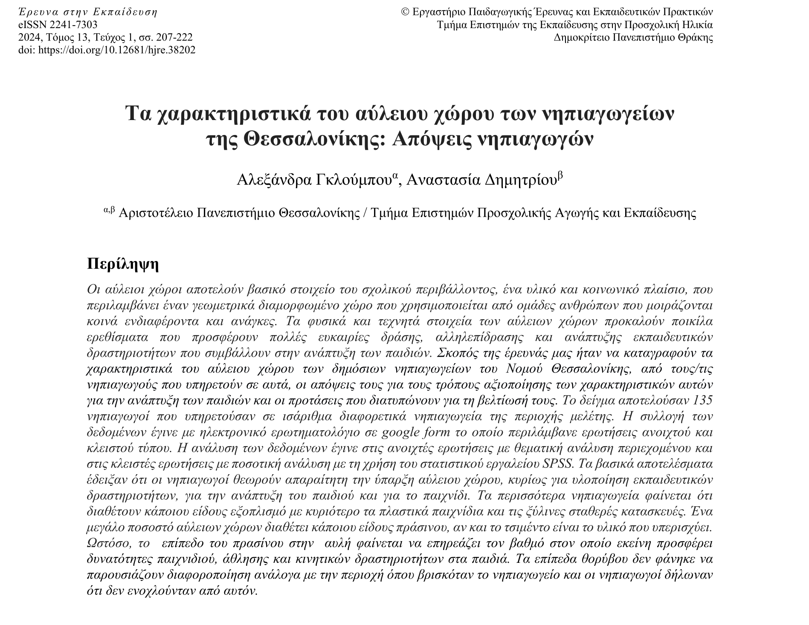
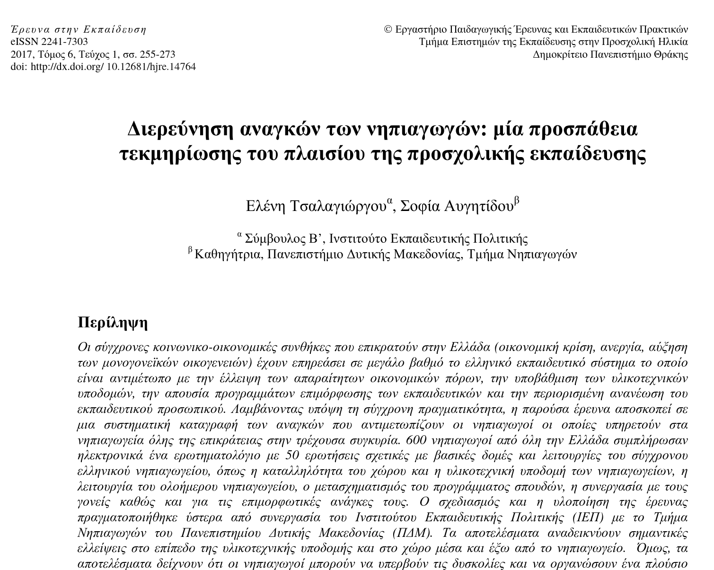

## Επιστημονική έρευνα
- Συστηματική, αντικειμενική διερεύνηση ερωτημάτων.
- Περιλαμβάνει ορισμό προβλήματος, ανασκόπηση της βιβλιογραφίας, συλλογή δεδομένων, ανάλυση και συμπεράσματα.
- Στόχος: αξιόπιστες απαντήσεις και δυνατότητα αναπαραγωγής των ευρημάτων.

## Ποσοτική έρευνα
- Διερεύνηση σχέσεων μεταξύ μεταβλητών που μπορούν να μετρηθούν.
- Έλεγχος υποθέσεων με αριθμητικά δεδομένα και στατιστικές μεθόδους.
- Έμφαση σε αντιπροσωπευτικά δείγματα, αξιοπιστία, εγκυρότητα.

## Σχέδια ποσοτικής έρευνας

- δημοσκοπική έρευνα
- έρευνα συσχέτισης
- αιτιακή-συγκριτική έρευνα
- πειραματική έρευνα
- πειραματική έρευνα ενός υποκειμένου

## Χαρακτηριστικά ποσοτικής προσέγγισης

- Προκαθορισμένες μεταβλητές και όργανα μέτρησης.
- Δειγματοληψία και εφαρμογή στατιστικών μεθόδων.
- Έλεγχος εξωγενών παραγόντων όπου είναι δυνατόν.
- Σκοπός: εκτιμήσεις, συσχετίσεις, ισχυρισμοί αιτιότητας (σε πειράματα).

# Δημοσκοπική έρευνα

## Γενικά

\

> **ΣΤΟΧΟΣ**
>
> Η κατανόηση της στάσης / γνώμης των ανθρώπων για κάποιο θέμα

\

Η συλλογή δεδομένων γίνεται με τη χρήση του **ερωτηματολογίου δημοσκόπησης**.

\

Η δημοσκόπηση μπορεί να είναι **δειγματοληπτική** ή **απογραφική**.

## Δυσκολίες

- Μικρά δείγματα σε σχέση με των αριθμό των ερωτηματολογίων που χρησιμοποιούνται.
- Απαντούν περισσότερο άνθρωποι με συγκεκριμένα χαρακτηριστικά ή απόψεις.
- Συχνά απαιτείται σχεδιασμός του ερωτηματολογίου.
- Ο ερευνητής σπάνια έχει πρόσβαση στους συμμετέχοντες για επεξήγηση των ερωτήσεων.

## Σχεδιασμός

- Συγχρονική δημοσκοπική έρευνα (cross-sectional survey)
- Διαχρονική δημοσκοπική έρευνα (longitudinal survey)

## Συγχρονική δημοσκοπική έρευνα

Τα δεδομένα συλλέγονται μία φορά και παρέχουν ένα **στιγμιότυπο** των τρεχουσών συμπεριφορών, στάσεων και πεποιθήσεων.

**ΠΛΕΟΝΕΚΤΗΜΑΤΑ**

- Γρήγορη ολοκλήρωση.

**ΜΕΙΟΝΕΚΤΗΜΑΤΑ**

- Δεν μπορούμε να παρακολουθήσουμε την εξέλιξη φαινομένων.
- Δεν μπορούμε να αξιολογήσουμε αιτιακές σχέσεις.

## Διαχρονική δημοσκοπική έρευνα 

Τα δεδομένα συλλέγονται πολλές φορές.

**ΠΛΕΟΝΕΚΤΗΜΑΤΑ**

- Παρακολούθηση εξέλιξης φαινομένων.
- Μπορούν να εξαχθούν συμπεράσματα αιτιότητας.

**ΜΕΙΟΝΕΚΤΗΜΑΤΑ**

- Απαιτούν μεγάλο χρονικό διάστημα για την ολοκλήρωσή τους.
- Μείωση των συμμετεχόντων όσο εξελίσσεται η μελέτη.

## Κατηγορίες διαχρονικών δημοσκοπικών ερευνών

**Δημοσκοπική έρευνα τάσεων** (trend survey):

Μελέτη ενός συγκεκριμένου πληθυσμού στο χρόνο με επαναλαμβανόμενες δειγματοληψίες.

> **ΠΑΡΑΔΕΙΓΜΑ**
>
> _Μελέτη της γνώμης των αποφοίτων του ΠΤΝ για την ισότητα των φύλων._

## Κατηγορίες διαχρονικών δημοσκοπικών ερευνών

**Δημοσκοπική έρευνα ομοταξίας** (cohort survey):

Μελέτη συγκεκριμένης ομάδας με τη χρήση πολλαπλών δειγματοληψιών.

> **ΠΑΡΑΔΕΙΓΜΑ**
>
> _Μελέτη της επίδρασης των lockdown στις εκπαιδευτικές προσγγίσεις των αποφοίτων παιδαγωγικών σχολών του 2019._

## Κατηγορίες διαχρονικών δημοσκοπικών ερευνών

**Δημοσκοπική έρευνα πάνελ** (panel survey):

Μελέτη συγκεκριμένης ομάδας με τη χρήση πολλαπλών μετρήσεων.

**ΠΡΟΣΟΧΗ**: Μετράμε πολλές φορές τους ίδιους ακριβώς ανθρώπους!

> **ΠΑΡΑΔΕΙΓΜΑ**
>
> _Μελέτη της επαγγελματικής ικανοποίησης 100 νηπιαγωγών της δημόσιας εκπαίδευσης._

## Κατηγορίες διαχρονικών δημοσκοπικών ερευνών

**Δημοσκοπική έρευνα παρακολούθησης** (follow-up survey):

Επανξέταση της ίδιας ομάδας ανθρώπων ύστερα από ένα χρονικό διάστημα.

> **ΠΑΡΑΔΕΙΓΜΑ**
>
> _Επανεξέταση μίας ομάδας εκπαιδευτικών 2 χρόνια μετά την παρακολούθηση ενός εκπαιδευτικού προγράμματος.
> Στόχος είναι να μελετηθεί αν ύστερα από μεγάλο διάστημα οι εκπαιδευτικοί εξακολουθούν να εφαρμόζουν όσα διδάχθηκαν._

## Διεξαγωγή δημοσκοπικής έρευνας

Οι δημοσκοπικές έρευνες έχουν δύο μορφές:

- Ερωτηματολόγιο
- Συνέντευξη

## Δημοσκοπική έρευνα με ερωτηματολόγιο

Τα ερωτηματολόγια χορηγούνται είτε σε χαρτί (π.χ. ταχυδρομικά) είτε σε ηλεκτρονική μορφή.

**ΠΛΕΟΝΕΚΤΗΜΑΤΑ**

- Οικονομικό.
- Συλλογή δεδομένων από μεγάλα δείγματα.

**ΜΕΙΟΝΕΚΤΗΜΑ**

- Δεν υπάρχει δυνατότητα διευκρινίσεων αν μία ερώτηση δεν είναι κατανοητή.

## Δημοσκοπική έρευνα με συνέντευξη

Οι ερωτήσεις γίνονται στους συμμετέχοντες από κατά τη διάρκεια προφορικής, κατά πρόσωπο συνεδρίας.

**ΠΛΕΟΝΕΚΤΗΜΑΤΑ**

- Υπάρχει δυνατότητα διευκρινίσεων αν μία ερώτηση δεν είναι κατανοητή.
- Μεγαλύτερη αξιοπιστία στα δεδομένα που συλλέγονται.
- Μπορεί να ηχογραφηθεί για μετέπειτα επεξεργασία.

**ΜΕΙΟΝΕΚΤΗΜΑΤΑ**

- Χρονοβόρα διαδικασία.
- Συνήθως μικρότερα δείγματα.

## Βήματα διεξαγωγής δημοσκόπησης

**Βήμα 1: Αναγνώριση του προβλήματος**

- Διατύπωση συγκεκριμένων στόχων.
- Διατύπωση γενικής ερώτησης.
- Επιμερισμός σε πιο συγκεκριμένα θέματα που συνθέτουν το κύριο.

## Βήματα διεξαγωγής δημοσκόπησης

**Βήμα 2: Κατασκευή του ερωτηματολογίου**

- Ερωτήσεις που να σχετίζονται με το θέμα. Κάθε ερώτηση να έχει ένα σκοπό.
- Να προτιμώνται οι δομημένες ερωτήσεις (π.χ. επιλογή από λίστα αποδεκτών απαντήσεων).
- Οι αδόμητες ερωτήσεις μπορεί να βοηθήσουν στην κατανόηση του σκεπτικού κάποιων απαντήσεων.

## Βήματα διεξαγωγής δημοσκόπησης

**Βήμα 2: Κατασκευή του ερωτηματολογίου**

- Ξεκάθαρες ερωτήσεις, με επεξηγήσεις διφορούμενων όρων.
- Να μην υπονοείται κάποια προτίμηση σε συγκεκριμένη απάντηση.
- Να μη γίνονται ερωτήσεις που προϋποθέτουν γεγονότα που μπορεί να μην ισχύουν (π.χ. ώρες χρήσης του εργαστηρίου Η/Υ).

## Βήματα διεξαγωγής δημοσκόπησης

**Βήμα 3: Πιλοτικός έλεγχος**

- Το ερωτηματολόγιο χορηγείται δοκιμαστικά σε μικρή ομάδα συμμετεχόντων.
- Η ομάδα αυτή πρέπει να είναι επίσης δείγμα από τον πληθυσμό στόχο.
- Ενθάρρυνση για κριτική.

> **ΤΕΛΙΚΟ ΠΡΟΪΟΝ**
>
> _Αναθεωρημένο ερωτηματολόγιο το οποίο θα υποβληθεί στην τελική ομάδα συμμετεχόντων._

## Βήματα διεξαγωγής δημοσκόπησης

**Βήμα 4: Συγγραφή συνοδευτικής επιστολής**

Κάθε ερωτηματολόγιο συνοδεύεται από επιστολή η οποία:

- Εξηγεί τους στόχους της έρευνας.
- Εξηγεί τη σημαντικότητα της έρευνας.
- Παρουσιάζει τα θέματα για τα οποία θα ερωτηθούν οι συμμετέχοντες.
- Δίνει στοιχεία επικοινωνίας σε περίπτωση ερωτήσεων/παρατηρήσεων.
- Μπορεί και αυτή να διανεμηθεί πιλοτικά.

## Βήματα διεξαγωγής δημοσκόπησης

**Βήμα 5: Επιλογή συμμετεχόντων**

- Καθορισμός πληθυσμού στόχου.
- Χρήση κάποιας μεθόδου δειγματοληψίας.

## Βήματα διεξαγωγής δημοσκόπησης

**Βήμα 6: Διανομή ερωτηματολογίου**

- Επιλογή μεθόδου διανομής (ηλεκτρονικά, προσωπικά, τηλεφωνικά, συνέντευξη)
- Να ακολουθούνται οι βασικές ηθικές αρχές της έρευνας.
  - Οι ερωτήσεις να μην είναι απειλητικές.
  - Να διασφαλίζεται η ανωνυμία καθ'όλη τη διάρκεια της έρευνας.

## Διαχείριση της άρνησης απάντησης

Οι δημοσκοπικές μελέτες ερωτηματολογίου χαρακτηρίζονται από μεγάλα ποσοστά άρνησης απάντησης.

Διερεύνηση της τυχαιότητας της άρνησης απάντησης:

- Διαλέγουμε ένα μικρό τυχαίο δείγμα συμμετεχόντων που απάντησαν.
- Διαλέγουμε ένα αντίστοιχο δείγμα από όσους δεν απάντησαν.
- Κάνουμε συνενέντευξη με όσους δεν απάντησαν.
- Συγκρίνουμε τις απαντήσεις των δύο δειγμάτων.

## Ανάλυση αποτελεσμάτων

- Απλή περιγραφική μελέτη παρουσιάζοντας τα ποσοστά των απαντήσεων που έλαβε η κάθε ερώτηση.
- Ομαδοποίηση ερωτήσεων και δημιουργία συνολικών βαθμολογιών ανά ομάδα.
- Διερεύνηση αν τα γενικά συμπεράσματα επιβεβαιώνονται σε υπο-ομάδες του πληθυσμού.

# Παραδείγματα

## Αύλειοι χώροι

## Θεωρητικό μέρος

- Χρησιμότητα αύλειων χώρων (γενικά).
- Από παιδαγωγική άποψη.
- Ρόλος αρχιτεκτονικών χαρακτηριστικών.
- Οι αύλειοι χώροι είναι υποβαθμισμένοι.
- Ειδικά στην Έλλάδα.
- Κινήματα που εντάσσουν τον άυλειο χώρο στην εκπαιδευτική διαδικασία.
- Στην Ελλάδα πολύ περιορισμένη έρευνα.

## Ερευνητικά ερωτήματα

- _Ποια είναι τα υφιστάμενα χαρακτηριστικά του αύλειου χώρου των νηπιαγωγείων του νομού Θεσσαλονίκης (υποδομή, φυσικά και
τεχνητά στοιχεία);_
- _Ποια είναι η άποψη των νηπιαγωγών γενικά για την ύπαρξη αύλειου χώρου στα νηπιαγωγεία και την
ποιότητά του και ειδικότερα για την ποιότητα των χαρακτηριστικών του αύλειου χώρου του
νηπιαγωγείου όπου υπηρετούν;_
- _Αν και σε ποιο βαθμό ο υφιστάμενος αύλειος χώρος του νηπιαγωγείου όπου υπηρετούν προσφέρει
ερεθίσματα και προκλήσεις στα παιδιά που συμβάλλουν στην ανάπτυξή τους;_

## Ερωτηματολόγια

Χρησιμοποιήθηκαν ερωτηματολόγια με 3 μέρη:

- Α' μέρος: Δημογραφικά
- Β' μέρος: Σχετικά με πρώτο και δεύτερο ερευνητικό ερώτημα.
- Γ' μέρος: Σχετικά με τρίτο ερευνητικό ερώτημα.

## Ανάγκες νηπιαγωγών

