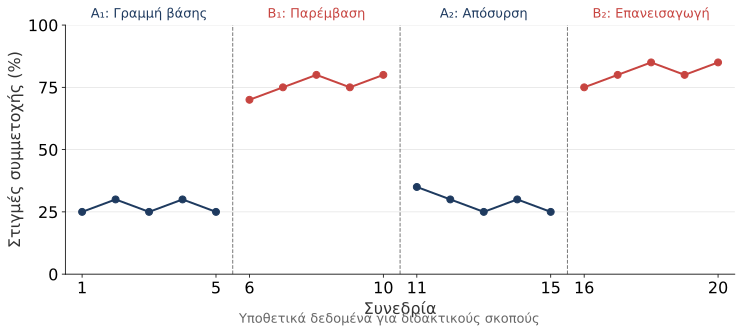
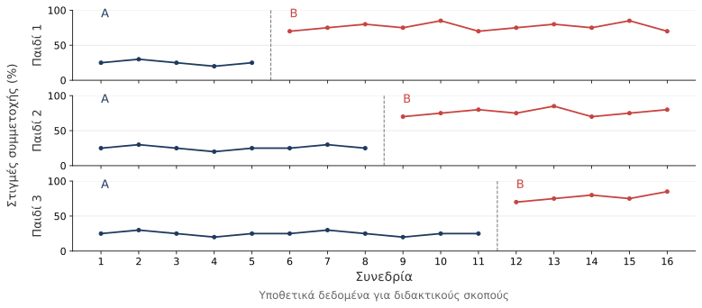
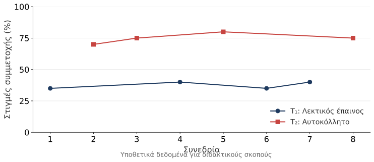

# Πειραματική έρευνα ενός υποκειμένου

## Γενικά

> **ΣΤΟΧΟΣ**
>
> _Διερεύνηση της αλλαγής στη συμπεριφορά ενός συγκεκριμένου ατόμου ως αποτέλεσμα μιας παρέμβασης._

\

- Επαναλαμβανόμενες μετρήσεις πριν και κατά την παρέμβαση.
- Σύγκριση της επίδοσης του ατόμου σε διαφορετικές συνθήκες.
- Κάθε συμμετέχων λειτουργεί ως **δικός του έλεγχος**.

## Τι σημαίνει «ενός υποκειμένου»;

- Μπορεί να συμμετέχει ένα άτομο ή μικρός αριθμός ατόμων.
- Η επίδοση κάθε ατόμου παρακολουθείται συστηματικά στον χρόνο.
- Το ενδιαφέρον εστιάζει στην αλλαγή για κάθε συγκεκριμένη περίπτωση.

\

Συναντάται και ο όρος **πειραματική έρευνα μεμονωμένης περίπτωσης**
(single-case experimental research).

::: {.notes}
Το βιβλίο αναφέρει και περιπτώσεις όπου μια ομάδα αντιμετωπίζεται ως μία μονάδα. Διευκρινίζουμε ότι το «single-subject» περιγράφει τη λογική του σχεδιασμού και δεν επιβάλλει συνολικό δείγμα ακριβώς ενός ατόμου.
:::

## Πότε είναι χρήσιμη;

- Όταν μας ενδιαφέρει η αποτελεσματικότητα μιας παρέμβασης για συγκεκριμένο παιδί.
- Όταν οι διαθέσιμοι συμμετέχοντες είναι λίγοι.
- Όταν χρειάζονται συχνές μετρήσεις μιας συμπεριφοράς.
- Σε εκπαιδευτικά πλαίσια και στην ειδική αγωγή.

## Πειραματικός έλεγχος

- Ο/Η ερευνητής/τρια εισάγει ή αποσύρει την παρέμβαση συστηματικά.
- Η συμπεριφορά μετριέται σε κάθε φάση.
- Εξετάζεται αν η αλλαγή επανεμφανίζεται μαζί με την αλλαγή των συνθηκών.

\

> **ΠΡΟΣΟΧΗ**
>
> _Μια περιγραφή ενός παιδιού ή μία μέτρηση πριν και μετά δεν αρκεί για να τεκμηριώσει την επίδραση της παρέμβασης._

# Βασικές αρχές

## Φάσεις και συμβολισμοί

| Σύμβολο | Σημασία                                              |
|:--------|:-----------------------------------------------------|
| **A**   | Γραμμή βάσης: συνθήκη χωρίς την υπό μελέτη παρέμβαση |
| **B**   | Συνθήκη εφαρμογής της παρέμβασης                     |
| **O**   | Παρατήρηση ή μέτρηση της συμπεριφοράς                |
| **X**   | Παρέμβαση                                            |

\

Σε **κάθε φάση** πραγματοποιούμε πολλές μετρήσεις.

::: {.notes}
Η φάση Α διατηρεί τη συνήθη εκπαιδευτική υποστήριξη. Δεν σημαίνει απουσία κάθε διδασκαλίας ή φροντίδας. Το Α2 δηλώνει επιστροφή στη συνθήκη χωρίς την πειραματική παρέμβαση, όχι βεβαιότητα ότι η συμπεριφορά θα επιστρέψει στο αρχικό της επίπεδο.
:::

## Γραμμή βάσης

> **ΟΡΙΣΜΟΣ**
>
> _Οι επαναλαμβανόμενες μετρήσεις που περιγράφουν τη συμπεριφορά πριν από την εισαγωγή της παρέμβασης._

\

- Δείχνει το συνηθισμένο επίπεδο και τη διακύμανση της συμπεριφοράς.
- Αποτελεί τη βάση σύγκρισης για την αξιολόγηση της αλλαγής.
- Χρειάζεται αρκετές παρατηρήσεις για να διακρίνουμε ένα μοτίβο.

## Σταθερότητα της γραμμής βάσης

- Η σταθερότητα δεν απαιτεί όλες οι τιμές να είναι ίδιες.
- Αναζητούμε ένα σχετικά προβλέψιμο επίπεδο ή μοτίβο.
- Αν η συμπεριφορά ήδη βελτιώνεται, η επίδραση της παρέμβασης είναι δυσκολότερο να διακριθεί.
- Ο αριθμός των μετρήσεων εξαρτάται από τη συμπεριφορά και τον σχεδιασμό.

::: {.notes}
Στις σ. 301–302 το βιβλίο αναφέρει τουλάχιστον τρία σημεία για την αναγνώριση γραμμής βάσης, συχνά περισσότερα. Δεν παρουσιάζουμε τα τρία σημεία ως καθολικό κριτήριο επάρκειας. Η διάρκεια και οι κανόνες μετάβασης χρειάζονται αιτιολόγηση. Τα διαγράμματα με πέντε παρατηρήσεις ανά φάση είναι απλουστευμένα παραδείγματα και όχι κανόνας σχεδιασμού.
:::

## Μία μεταβλητή κάθε φορά

Σε κάθε αλλαγή φάσης μεταβάλλουμε **ένα στοιχείο της παρέμβασης**.

\

> **ΠΑΡΑΔΕΙΓΜΑ**
>
> _Εισάγουμε συγκεκριμένο λεκτικό έπαινο για τη συμμετοχή, διατηρώντας ίδια τη διάρκεια, τη δραστηριότητα και τον τρόπο μέτρησης._

\

Αν αλλάξουν ταυτόχρονα η παρέμβαση και η δραστηριότητα, δεν μπορούμε να ξεχωρίσουμε την επίδρασή τους.

## Μεταβλητές της μελέτης

**Ανεξάρτητη μεταβλητή:**  
Η παρέμβαση που εφαρμόζουμε συστηματικά.

\

**Εξαρτημένη μεταβλητή:**  
Η συμπεριφορά ή επίδοση που μετράμε επανειλημμένα.

\

> **ΠΑΡΑΔΕΙΓΜΑ**
>
> _Συγκεκριμένος λεκτικός έπαινος και ποσοστό παρατηρήσεων ενεργού συμμετοχής._

## Βασικές κατηγορίες σχεδίων

Οι σχεδιασμοί ενός υποκειμένου διακρίνονται σε:

- Σχέδια απόσυρσης της παρέμβασης.
- Σχέδια πολλαπλών γραμμών βάσης.
- Σχέδια εναλλασσόμενων παρεμβάσεων.

\

Η επιλογή εξαρτάται από το ερώτημα, τη συμπεριφορά και τη δυνατότητα απόσυρσης της παρέμβασης.

# Σχέδια απόσυρσης

## Σχέδιο A–B

1. Καταγράφουμε τη συμπεριφορά στη γραμμή βάσης (**A**).
2. Εισάγουμε την παρέμβαση (**B**).
3. Συνεχίζουμε τις επαναλαμβανόμενες μετρήσεις.

\

| Α: Βάση | Β: Παρέμβαση |
|:-------:|:------------:|
|  ΟΟΟΟΟ  |  ΧΟΧΟΧΟΧΟΧ   |

> **ΠΡΟΣΟΧΗ**
>
> _Μια βελτίωση στη φάση B μπορεί να οφείλεται και σε άλλους παράγοντες. Ο σχεδιασμός Α-Β δύσκολα τεκμηριώνει αιτιότητα._

## Σχέδιο A–B–A

Προσθέτουμε μία φάση **απόσυρσης** της παρέμβασης.

\

| $A_1$: Βάση | $B$: Παρέμβαση | $A_2$: Απόσυρση |
|:-----------:|:--------------:|:---------------:|
|    ΟΟΟΟΟ    |   ΧΟΧΟΧΟΧΟΧ    |      ΟΟΟΟΟ      |

\

Αν η συμπεριφορά αλλάξει στη B και επιστρέψει προς το αρχικό επίπεδο στην A₂, ενισχύεται η ένδειξη επίδρασης της παρέμβασης.

## Σχέδιο A–B–A: Περιορισμοί

- Η συμπεριφορά μπορεί να μην επιστρέφει στο αρχικό επίπεδο.
- Η μάθηση μπορεί να διατηρείται μετά την απόσυρση.
- Η μελέτη τελειώνει χωρίς την υπό μελέτη παρέμβαση.
- Η απόσυρση μιας ωφέλιμης παρέμβασης μπορεί να δημιουργεί ηθικό πρόβλημα.

> **ΠΡΟΣΟΧΗ**
> 
> _Απουσία επιστροφής στη γραμμή βάσης δεν σημαίνει αυτόματα απουσία αποτελεσματικότητας._

## Σχέδιο A–B–A–B

Προσθέτουμε δεύτερη φάση εφαρμογής της ίδιας παρέμβασης.

\

| $A_1$: Αναφορά | $B_1$: Παρέμβαση | $A_2$: Αναφορά | $B_2$: Παρέμβαση |
|:--------------:|:----------------:|:--------------:|:----------------:|
|     ΟΟΟΟΟ      |    ΧΟΧΟΧΟΧΟΧ     |     ΟΟΟΟΟ      |   ΧΟΧΟΧΟΧΟΧΟ    |

\

- Ελέγχουμε αν η αλλαγή εμφανίζεται ξανά.
- Η μελέτη τελειώνει με εφαρμογή της παρέμβασης.

::: {.notes}
Η κατάληξη στη B₂ αντιμετωπίζει το πρόβλημα της λήξης χωρίς παρέμβαση. Δεν αίρει από μόνη της το ηθικό πρόβλημα της προσωρινής απόσυρσης στην A₂. Αν η απόσυρση ενέχει κίνδυνο, επιλέγουμε διαφορετικό σχέδιο.
:::

## Παράδειγμα A–B–A–B

{fig-alt="Υποθετικά δεδομένα: η συμμετοχή είναι χαμηλή στην Α1, αυξάνεται στη Β1, μειώνεται στην Α2 και αυξάνεται ξανά στη Β2." width=100%}

::: {.notes}
Διδακτικά δεδομένα, όχι δημοσιευμένα αποτελέσματα. Συγκεκριμένος λεκτικός έπαινος στη Β, συνήθης υποστήριξη στην Α. Διαβάζουμε πρώτα άξονες, μονάδα μέτρησης και όρια φάσεων. Δεν ενώνουμε τα σημεία μεταξύ διαφορετικών φάσεων. Συζητάμε αν το επαναλαμβανόμενο μοτίβο συμβαδίζει με την εφαρμογή της παρέμβασης. Η προσωρινή απόσυρση εξετάζεται μόνο αν είναι αποδεκτή και ασφαλής.
:::

## Παραλλαγές

**B–A–B:**

- Ξεκινά με παρέμβαση και τελειώνει με παρέμβαση.
- Η απουσία αρχικής γραμμής βάσης δυσκολεύει την αξιολόγηση.

# Πολλαπλές γραμμές βάσης

## Γενικά

Χρησιμοποιείται όταν:

- Η απόσυρση της παρέμβασης δεν είναι εφικτή ή ηθικά αποδεκτή.
- Η επίδραση της παρέμβασης διατηρείται μετά τη διακοπή της.
- Θέλουμε να εξετάσουμε την αλλαγή σε διαφορετικές περιπτώσεις/συμπεριφορές.

\

Η παρέμβαση εισάγεται **σε διαφορετικές χρονικές στιγμές** σε κάθε σειρά μετρήσεων.

## Βασικοί τύποι

| Τύπος                | Τι παρακολουθούμε;                                       |
|:---------------------|:---------------------------------------------------------|
| Μεταξύ συμπεριφορών  | Διαφορετικές συμπεριφορές του ίδιου παιδιού              |
| Μεταξύ συμμετεχόντων | Την ίδια συμπεριφορά διαφορετικών παιδιών                |
| Μεταξύ περιβαλλόντων | Την ίδια συμπεριφορά ενός παιδιού σε διαφορετικά πλαίσια |

## Λογική του σχεδιασμού

1. Μετράμε παράλληλα όλες τις σειρές στη γραμμή βάσης.
2. Εισάγουμε την παρέμβαση στην πρώτη σειρά.
3. Διατηρούμε τις υπόλοιπες σειρές στη γραμμή βάσης.
4. Εισάγουμε σταδιακά την παρέμβαση στις επόμενες σειρές.

\

Αναζητούμε αλλαγή **μόνο μετά** την εισαγωγή της παρέμβασης σε κάθε σειρά.

## Λογική του σχεδιασμού

| Συπεριφορά | Α: Βάση | Β: Παρέμβαση   |
|:----------:|:-------|:---------------|
|     1      |      ΟΟ | ΧΟΧΟΧΟΧΟΧΟΧΟΧΟ |
|     2      |     ΟΟΟ | ΧΟΧΟΧΟΧΟΧΟΧΟ   |
|     3      |    ΟΟΟΟ | ΧΟΧΟΧΟΧΟΧΟ     |

## Παράδειγμα μεταξύ συμμετεχόντων

{fig-alt="Τρεις παράλληλες σειρές υποθετικών μετρήσεων. Η συμμετοχή αυξάνεται μετά την έναρξη της παρέμβασης στις συνεδρίες 6, 9 και 12 αντίστοιχα." width=100%}

::: {.notes}
Ίδια συμπεριφορά και ίδια παρέμβαση σε τρία παιδιά. Έναρξη στη συνεδρία 6 για το πρώτο, 9 για το δεύτερο και 12 για το τρίτο. Πριν από κάθε έναρξη ελέγχουμε την προβλεψιμότητα της αντίστοιχης γραμμής βάσης. Το βιβλίο αναφέρει τρεις επαναλήψεις ως συνήθως αποδεκτό ελάχιστο στο συγκεκριμένο πλαίσιο (σ. 298), όχι ως επαρκή από μόνες τους συνθήκη ποιότητας. Όλες οι τιμές είναι διδακτικές.
:::

## Προϋποθέσεις και δυσκολίες

- Οι σειρές χρειάζεται να μπορούν να μεταβληθούν σχετικά ανεξάρτητα.
- Η παρέμβαση για μία συμπεριφορά δεν πρέπει να αλλάζει ταυτόχρονα τις υπόλοιπες.
- Η εφαρμογή και η μέτρηση χρειάζονται συνέπεια μεταξύ περιπτώσεων.
- Η αναμονή σε γραμμή βάσης χρειάζεται ηθική αιτιολόγηση.

# Εναλλασσόμενες παρεμβάσεις

## Γενικά

> **ΣΤΟΧΟΣ**
>
> _Σύγκριση της σχετικής αποτελεσματικότητας δύο ή περισσότερων παρεμβάσεων στο ίδιο άτομο._

\

- Σχετικά γρήγορη εναλλαγή των συνθηκών.
- Επαναλαμβανόμενη μέτρηση της ίδιας συμπεριφοράς.
- Τυχαία σειρά εφαρμογής για τον περιορισμό επιδράσεων της σειράς.

## Παράδειγμα

Για το ίδιο παιδί συγκρίνουμε:

- **T₁:** συγκεκριμένο λεκτικό έπαινο.
- **T₂:** επιβράβευση με αυτοκόλλητο.

\

Ενδεικτική σειρά συνεδριών:

**T₁, T₂, T₂, T₁, T₂, T₁, T₁, T₂**

\

Ίδια δραστηριότητα, ίδια διάρκεια και ίδιος τρόπος παρατήρησης.

::: {.notes}
Η σειρά αναπαριστά την τυχαία εναλλαγή του παραδείγματος στη σ. 300. Για τις μάρκες πρέπει να οριστούν η χορήγηση και η ανταλλαγή τους. Συγκρίνουμε τα δύο συγκεκριμένα πρωτόκολλα, χωρίς να ισχυριζόμαστε ότι απομονώνεται κάθε συστατικό τους.
:::

## Παράδειγμα εναλλαγής

{fig-alt="Υποθετικές τιμές συμμετοχής σε οκτώ συνεδρίες: οι τιμές για τη συνθήκη Τ2 είναι σταθερά υψηλότερες από εκείνες της Τ1." width=100%}

::: {.notes}
Κάθε σημείο είναι μία συνεδρία. Οι ξεχωριστές γραμμές συνδέουν μόνο σημεία της ίδιας συνθήκης. Η Τ2 συνδέεται με μεγαλύτερη συμμετοχή για το συγκεκριμένο παιδί και υπό τους συγκεκριμένους όρους. Δεν συμπεραίνουμε αποτελεσματικότητα έναντι απουσίας παρέμβασης ούτε γενίκευση σε όλα τα παιδιά.
:::

## Πλεονεκτήματα και περιορισμοί

**ΠΛΕΟΝΕΚΤΗΜΑΤΑ**

- Σύντομη σύγκριση διαφορετικών παρεμβάσεων.
- Δεν απαιτείται αρχική γραμμή βάσης για τη σχετική σύγκριση.
- Μπορούμε να συνεχίσουμε την αποτελεσματικότερη συνθήκη.

\

**ΠΕΡΙΟΡΙΣΜΟΣ**

Η επίδραση μιας παρέμβασης μπορεί να μεταφέρεται στην επόμενη συνθήκη και να δυσκολεύει την ερμηνεία.

# Ανάλυση και ερμηνεία

## Οπτική ανάλυση

Πρώτα αξιολογούμε αν ο σχεδιασμός επιτρέπει ασφαλή ερμηνεία.

\

Στη συνέχεια εξετάζουμε:

- Το επίπεδο των τιμών σε κάθε φάση.
- Την τάση και τη μεταβλητότητα.
- Την αμεσότητα της αλλαγής μετά την αλλαγή φάσης.
- Την επικάλυψη των τιμών και τη συνέπεια του μοτίβου.

::: {.notes}
Το βιβλίο θεμελιώνει την ανάλυση στην οπτική εξέταση των γραφημάτων (σ. 300). Τα επιμέρους ερωτήματα εδώ αποτελούν διδακτική εξειδίκευση της διαδικασίας και όχι κατά λέξη κατάλογο του κεφαλαίου. Δεν στηρίζουμε αιτιακό συμπέρασμα μόνο στη διαφορά μέσων όρων.
:::

## Πρακτική σημασία

Μας ενδιαφέρει αν η αλλαγή κάνει **ουσιαστική διαφορά** για το παιδί.

\

- Πόσο μεγάλη είναι η βελτίωση;
- Διευκολύνει τη συμμετοχή στη δραστηριότητα;
- Διατηρείται με την πάροδο του χρόνου;
- Εμφανίζεται και σε άλλα περιβάλλοντα;

\

Η στατιστική σημαντικότητα από μόνη της δεν αρκεί για να δείξει εκπαιδευτική χρησιμότητα.

::: {.notes}
Ο όρος του βιβλίου είναι «κλινική σημαντικότητα». Εδώ συνδέεται και με την εκπαιδευτική πράξη. Στατιστικές αναλύσεις μπορούν να συμπληρώνουν την οπτική ανάλυση, αλλά χρειάζονται μεθόδους κατάλληλες για επαναλαμβανόμενες και πιθανώς εξαρτημένες χρονικά μετρήσεις. Δεν προτείνουμε απλό t-test σαν οι συνεδρίες να ήταν ανεξάρτητοι συμμετέχοντες.
:::

# Εγκυρότητα και επανάληψη

## Εσωτερική εγκυρότητα

Σε ποιον βαθμό η αλλαγή μπορεί να αποδοθεί στην παρέμβαση;

\

Βασικές απειλές:

- Άλλα γεγονότα που συμπίπτουν με την αλλαγή φάσης.
- Φυσική εξέλιξη ή εξοικείωση με τη δραστηριότητα.
- Αλλαγή παρατηρητή ή τρόπου μέτρησης.
- Ασυνεπής εφαρμογή της παρέμβασης.

::: {.notes}
Οι επαναλαμβανόμενες μετρήσεις βοηθούν να παρακολουθούμε τις αλλαγές, αλλά δεν εξαλείφουν αυτομάτως την ιστορία ή την ωρίμανση. Η επανεμφάνιση του αποτελέσματος σε διαφορετικές αλλαγές συνθηκών ενισχύει τον έλεγχο εναλλακτικών εξηγήσεων.
:::

## Αξιόπιστες μετρήσεις

- Σαφής ορισμός της συμπεριφοράς και κανόνες καταγραφής.
- Σταθερή διάρκεια και συγκρίσιμες συνθήκες παρατήρησης.
- Εκπαίδευση των παρατηρητών.
- Έλεγχος συμφωνίας μεταξύ παρατηρητών.
- Έλεγχος συνέπειας του ίδιου παρατηρητή στον χρόνο.

\

> **ΠΡΟΣΟΧΗ**
>
> _Αλλαγή της μέτρησης μαζί με την αλλαγή φάσης μπορεί να δημιουργήσει πλασματική επίδραση._

## Συνεπής εφαρμογή

Περιγράφουμε με ακρίβεια:

- Τι κάνει ο/η εκπαιδευτικός.
- Πότε και πόσο συχνά εφαρμόζεται η παρέμβαση.
- Ποια υλικά χρησιμοποιούνται.
- Πώς ελέγχεται η τήρηση της διαδικασίας.

\

Στη δεύτερη εφαρμογή της B χρησιμοποιούμε **το ίδιο πρωτόκολλο**.

## Εξωτερική εγκυρότητα

Σε ποιους άλλους και σε ποιες συνθήκες ισχύουν τα ευρήματα;

\

- Ένα θετικό αποτέλεσμα για ένα παιδί δεν εξασφαλίζει γενίκευση.
- Η αρχική περίοδος παρατήρησης μπορεί να επηρεάζει την ανταπόκριση στην παρέμβαση.
- Χρειάζονται νέες εφαρμογές σε άλλα παιδιά και περιβάλλοντα.
- Η λεπτομερής περιγραφή δείχνει τα όρια των συμπερασμάτων.
- Η επανάληψη ενισχύει την εμπιστοσύνη στα ευρήματα και αποσαφηνίζει πού εφαρμόζονται.

::: {.notes}
Χρησιμοποιούμε την ορολογία του συγκεκριμένου κεφαλαίου (σ. 302). Η κλινική επανάληψη αφορά την ανάπτυξη πακέτου για σύνθετες ανάγκες. Δεν σημαίνει ταυτόχρονη αλλαγή πολλών ανεξέλεγκτων στοιχείων σε μία μετάβαση φάσης. Η ταυτόχρονη επανάληψη περιγράφεται ως ειδική περίπτωση με διαφορετικούς συμμετέχοντες στον ίδιο χώρο και χρόνο.
:::

## Ηθικά ζητήματα

- Ενημερωμένη συγκατάθεση κηδεμόνων και κατάλληλη συναίνεση του παιδιού.
- Προστασία της ιδιωτικότητας και χρήση ψευδωνύμων.
- Σαφή κριτήρια διακοπής αν εμφανιστεί επιβάρυνση.
- Αιτιολόγηση της αναμονής ή της απόσυρσης της παρέμβασης.

\

**Όταν η απόσυρση δημιουργεί κίνδυνο, επιλέγουμε διαφορετικό σχέδιο.**

::: {.notes}
Το κεφάλαιο επισημαίνει κυρίως το ηθικό ζήτημα της απόσυρσης. Η διαφάνεια επεκτείνει τη συζήτηση στην εκπαιδευτική έρευνα με παιδιά. Δεν σχεδιάζουμε απόσυρση αναγκαίας υποστήριξης για λόγους επίδειξης του σχεδιασμού.
:::

# Ανακεφαλαίωση

## Βασικά σημεία

- Κάθε συμμετέχων λειτουργεί ως δικός του έλεγχος.
- Η συμπεριφορά μετριέται επανειλημμένα σε κάθε συνθήκη.
- Η επιλογή σχεδίου εξαρτάται από τη δυνατότητα απόσυρσης και το ερώτημα.
- Η οπτική ανάλυση συνδέει τις αλλαγές της συμπεριφοράς με τις αλλαγές φάσης.
- Η γενίκευση απαιτεί επανάληψη σε περισσότερες περιπτώσεις.

## Ερωτήματα για συζήτηση

1. Γιατί ένα σχέδιο A–B δεν αρκεί για ισχυρό αιτιακό συμπέρασμα;
2. Ποιο σχέδιο ταιριάζει όταν η δεξιότητα που διδάσκεται διατηρείται;
3. Τι θα σήμαινε αν όλα τα παιδιά βελτιώνονταν πριν από τη δική τους παρέμβαση;
4. Πότε μια μικρή αριθμητική αλλαγή έχει ουσιαστική εκπαιδευτική σημασία;

::: {.notes}
Ενδεικτικά σημεία συζήτησης: (1) πιθανές εναλλακτικές εξηγήσεις χωρίς επανεμφάνιση αποτελέσματος, (2) πολλαπλή γραμμή βάσης όταν δεν είναι λογική η επιστροφή, (3) κοινό γεγονός, μεταφορά ή άλλη εξήγηση που αποδυναμώνει τον έλεγχο, (4) σύνδεση με λειτουργικούς στόχους του παιδιού και της τάξης. Δεν υπάρχει καθολικό ποσοστό που να ορίζει τη χρησιμότητα.
:::

